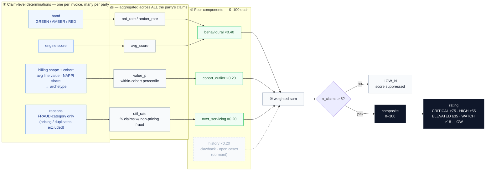

# How the RIE Determines Party-Level Risk

*The companion to [how-risk-is-determined.md](how-risk-is-determined.md). That document explains how **one claim** becomes a risk verdict. This one explains the other half: how a **party** — a provider, an attorney, a claimant — is scored across **all** of its claims. Written from the code (`server/party_scoring.py`, the pure scoring core, and `server/party_intel_service.py`, which builds the inputs from the corpus), not from intent.*

> **Scope.** This is **party-level** risk: a standing score on an *actor*, emergent from the whole corpus of that actor's claims. It is distinct from, and computed on top of, claim-level risk. It never blocks a payment — that is the claim's eligibility gate (see the companion). Party risk **prioritises attention**: who to look at, in what order.

---

## 1. Two different questions

| | Claim-level risk | Party-level risk (this document) |
|---|---|---|
| **Unit** | one submitted claim | one provider / attorney / claimant |
| **Question** | *how much does this claim have to answer for, where does it route, can it pay?* | *how much should we scrutinise this actor, across everything they touch?* |
| **Output** | band + disposition + eligibility | a composite **0–100 score**, a **rating**, and a **component breakdown** |
| **Effect** | gates and prices a payment | ranks actors for review; opens no gate |
| **Computed by** | `engine.process_claim` (deterministic, per claim) | `party_scoring.party_risk` over aggregated corpus stats |

The two are connected: **party risk is emergent from claim risk.** Almost every input to a party's score is an aggregate of the per-claim determinations its claims produced — how often they banded `RED`, their mean engine score, how often a genuine fraud reason fired. Claim-level risk scores *invoices*; party-level risk scores the *hand behind them*.

### The pipeline at a glance — claim axis → party aggregate

Read left to right. Each **claim-level output** (band, engine score, fraud reasons) is aggregated across *all* of a party's claims into a **party statistic**, which feeds one of the **four components**, which weight into the **composite score** and its **rating**. The arrows are the exact data dependencies in `party_scoring.py`.



*Dashed = dormant: `history` is carried at weight 0.20 but contributes 0 until the recovery and case feeds land (principle 4). Everything else is live.*

---

## 2. Four principles that shape the whole design

Before the formula, the four commitments that make party scoring defensible (all enforced in `party_scoring.py`):

1. **Cohort-relative, never absolute.** A party is compared **only to its own kind** — a medico-legal specialist is not held to a GP's numbers, a high-volume litigation firm is not judged against a boutique. Comparison is *within cohort*, which is the primary false-positive control (§5).
2. **n-guarded.** Below `MIN_ROBUST = 5` claims, a party is **not scored at all** — it returns confidence `LOW_N`, score `0`. You cannot draw a risk conclusion from three invoices, so the system refuses to. A mostly-clean corpus showing many `LOW`/`LOW_N` parties is the expected, correct picture.
3. **Pricing and duplicate billing are excluded — deliberately.** Billing over the reference or billing a duplicate line is **repriced or dropped at adjudication** (the claim-level `ADJUSTED` lane); it is *not* fraud. So the party score's "flag" input counts **only non-pricing fraud reasons** — a provider is never made to look like a fraud suspect for over-billing that the payment rule already neutralised.
4. **Enrichment without rewrite.** Some component inputs (after-hours place-of-service, clawback history, open-case count) are **dormant** — their feeds/modules aren't live yet. The formula already carries them at weight, so the score *deepens* as those signals arrive, without a scoring change.

---

## 3. The composite score (`party_risk`)

A party's risk is a single **0–100 composite** of four weighted components:

```
components = {
    behavioural    = min(100,  red_rate*1.5 + amber_rate*0.4 + min(avg_score, 40))
    cohort_outlier = min(100,  max(0, value_p − 75)*4  +  max(0, afterhours_p − 80)*2)
    over_servicing = min(100,  util_rate*4)
    history        = min(100,  clawback_rate*8  +  n_open_cases*20)
}

if n_claims < 5:                       # MIN_ROBUST
    return score = 0, rating = LOW, confidence = LOW_N   # refuse to score

score  = 0.40*behavioural + 0.20*cohort_outlier + 0.20*over_servicing + 0.20*history
rating = CRITICAL if score ≥ 75
         HIGH     if score ≥ 55
         ELEVATED if score ≥ 35
         WATCH    if score ≥ 18
         LOW      otherwise
```

The weights say what matters most: **behaviour (0.40)** — how this party's claims actually score — carries twice the weight of any other component. Cohort-outlier, over-servicing, and history each carry **0.20**.

### 3.1 The rating ladder

| Rating | Score | Reading |
|---|---|---|
| **CRITICAL** | 75 – 100 | look now |
| **HIGH** | 55 – 74 | on the shortlist |
| **ELEVATED** | 35 – 54 | worth a look |
| **WATCH** | 18 – 34 | keep an eye |
| **LOW** | 0 – 17 | nothing standing out |
| *(LOW_N)* | — | too few claims to judge (`< 5`) — score suppressed |

---

## 4. The four components, in detail

### 4.1 Behavioural (weight 0.40) — *how this party's own claims score*

```
behavioural = min(100, red_rate*1.5 + amber_rate*0.4 + min(avg_score, 40))
```

The heaviest component, and the most direct: it reads the party's claims' **claim-level outcomes** back onto the party.

- `red_rate` — the % of the party's claims that banded **RED**, weighted ×1.5 (a RED claim is the strongest per-party signal).
- `amber_rate` — the % that banded **AMBER**, weighted ×0.4.
- `min(avg_score, 40)` — the party's **mean engine score**, capped at 40 so a single component can't dominate.

A provider whose claims routinely carry fraud features scores high here; a provider whose claims are consistently clean scores near zero. This is the bridge from claim-level risk to party-level risk.

### 4.2 Cohort-outlier (weight 0.20) — *how far above its peers it bills*

```
cohort_outlier = min(100, max(0, value_p − 75)*4 + max(0, afterhours_p − 80)*2)
```

- `value_p` — the party's **within-cohort value percentile** (§5): where its average claim value sits *among its own archetype*. The term `max(0, value_p − 75)*4` is **zero until the 75th percentile** and then ramps steeply — so only a party in the **top quarter of its cohort** contributes, and a party at the 90th percentile contributes `(90−75)*4 = 60`. Being expensive *for a specialist* is normal; being expensive *for your own specialty* is the signal.
- `afterhours_p` — *(dormant)* the share of services rendered outside normal hours, active only above the 80th percentile, once a place-of-service feed exists.

### 4.3 Over-servicing (weight 0.20) — *how often a real fraud reason fires*

```
over_servicing = min(100, util_rate*4)
```

`util_rate` is the **% of the party's claims that carry a non-pricing fraud reason** — i.e. a claim-level reason whose register category is `FRAUD` (`DX_ACCIDENT_MISMATCH`, `IMPOSSIBLE_DAY`, `MATERIAL_PADDING`, …). Pricing and duplicate reasons (`BILLED_OVER_REFERENCE`, `DUPLICATE_LINE` — both `ADJUSTED`) are **excluded by construction** (principle 3). At `util_rate = 25%` this component saturates (`25*4 = 100`), so a party flagging genuine fraud on a quarter of its claims maxes it out.

### 4.4 History (weight 0.20) — *what has already been proven against it*

```
history = min(100, clawback_rate*8 + n_open_cases*20)
```

- `clawback_rate` — *(dormant)* the % of the party's paid claims later clawed back, once the recovery module feeds it (each point of clawback ×8).
- `n_open_cases` — *(dormant)* the count of open investigation cases against the party (each ×20, so five open cases saturate it).

Both are carried at weight now and light up as the Audit and Cases modules supply them — the "enrichment without rewrite" principle in action.

---

## 5. Cohorts and the within-cohort percentile (the false-positive control)

The entire design rests on comparing like with like. Two things do that: the **archetype** (which cohort a party belongs to) and the **within-cohort percentile** (where it sits inside that cohort).

### 5.1 Provider archetypes (data-derived, `party_intel_service._archetype`)

A provider's cohort is inferred from its own billing shape — no manual classification:

| Archetype | Assigned when |
|---|---|
| **MATERIALS** | NAPPI (medicine/consumable) lines are **≥ 60%** of the provider's lines (`_MATERIALS_SHARE`) |
| **SPECIALIST** | average line value **≥ R800** (`_SPECIALIST_VALUE`) and not materials-dominated |
| **GENERAL** | everything else (e.g. rooms GPs) |

> **Planned cohort enrichment (dormant, like `afterhours_p`).** These three billing-shape
> archetypes are the V1. The target set (domain-logic §7) adds setting- and discipline-derived
> cohorts — ER/trauma unit · hospital-based · rooms GP · allied/rehab · **medico-legal expert
> practice** · ambulance/EMS — activating as discipline and place-of-service data land.
> Priority is the **medico-legal expert** cohort: an assessment-dominated practice currently
> pools into `SPECIALIST` (avg line ≥ R800) and can climb `value_p` against treating
> specialists — exactly the false positive the cohort design exists to prevent. Until that
> cohort exists, treat a high `value_p` on an assessment-heavy practice with suspicion of the
> *score*, not the provider.

### 5.2 Attorney cohorts (by volume)

| Cohort | Assigned when |
|---|---|
| **HIGH_VOLUME** | ≥ 10 claims |
| **BOUTIQUE** | 3 – 9 claims |
| **GENERAL** | 1 – 2 claims |

### 5.3 The within-cohort percentile

`value_p` is a **midrank percentile** — the party's standing *within its cohort's distribution*:

```
percentile(values, x) = 100 * (count(v < x) + 0.5*count(v == x)) / len(values)
```

For **providers**, `x` is the provider's average line value and `values` is the average line value of **every provider in the same archetype**. For **attorneys**, `x` is the attorney's claim volume and `values` is the volume of every attorney — a volume-outlier proxy (a firm lodging far more than its peers). The half-weight on ties (`0.5*count(==)`) is a standard midrank convention so identical values share a rank rather than jumping.

Because the percentile is computed *inside* the cohort, a legitimately high-value specialist sits mid-pack among specialists (low `value_p`), and only a provider expensive **relative to its own kind** climbs. This is what stops the score from simply flagging "expensive".

---

## 6. The three party types

### 6.1 Providers (`providers`)

Built by aggregating **billing lines** by `provider_id`, then reading the **claim-level determinations** of the claims those lines belong to:

- From the lines: line count, NAPPI share, total billed, **average line value** → archetype + within-cohort `value_p`.
- From the determinations: `red_rate`, `amber_rate`, `avg_score`, and `util_rate` (the non-pricing-fraud share) via `_band_stats`.
- These become a `PartyStats`, scored by `party_risk`. Output includes the archetype, counts, `value_percentile`, `red_rate`, `flag_rate` (= `util_rate`), the composite score, rating, confidence, and the component breakdown. Sorted worst-first.

### 6.2 Attorneys (`attorneys`)

Aggregated from claim records carrying an `attorney`:

- **Claim-type mix** (a Counter over `PERSONAL`/`SUPPLIER`/… — concentration is a tell).
- **Late-lodgement share** — the % of the attorney's claims lodged **more than 2.5 years** after the accident (a near-prescription chaser's fingerprint).
- Band stats over the attorney's claims + a **volume-percentile** cohort-outlier proxy → `PartyStats` → `party_risk`. Sorted worst-first.

### 6.3 A fourth party type — medico-legal experts (designed, pending)

The design (domain-logic §7) defines a fourth scored party type that is not yet implemented:
**medico-legal experts**, scored on their **WPI distribution vs their specialty cohort**
(an expert whose serious-injury rate sits P95+ within specialty), narrative-test share, and
RAF 4 reject/overturn rate — feeding the designed-pending signals `WPI_INFLATION` and
`EXPERT_MILL`. It requires the RAF 4 register data and the expert-discipline feed; when it
lands, it follows the same `PartyStats → party_risk` shape and the same n-guard.

### 6.4 Claimants (`claimants`) — recurrence only

Claimants are **not** given a composite score. The only party-level claimant signal is **recurrence**: a pseudonymous claimant token (`P_*`) appearing across **two or more accidents** on the accident graph. The output lists each recurring token, its accident count, and the accident ids — a **thread to pull** (a possible ring or serial claimant), not a verdict. Whether recurrence is coincidence or collusion is a human call; the system surfaces it, ranked by accident count.

---

## 7. The risk sweep — one dial across every party

`risk_sweep` (`GET /api/parties/risk-sweep`) is the operator's single control over where the review line falls. It takes **one threshold** (default `55`) and returns **every provider *and* attorney whose composite score ≥ threshold**, merged and sorted worst-first, each tagged `type: provider | attorney`. Lower the threshold to cast a wider net; raise it to see only the worst.

**It is read-only.** The sweep produces a **shortlist**; it opens nothing. Acting on a flagged party — opening a `BLOCK` or `CLAWBACK` investigation case — is a **deliberate operator step** in the Cases module, subject to that module's role gating. (Contrast the two sweeps that *do* create work automatically: the **Audit recovery sweep**, which opens post-payment clawback items, and the **Governance QA draw**, which opens blind-review cases. The party risk sweep is a *lens*, not an *actuator* — by design, so that scoring an actor high never, by itself, initiates action against them.) *This deliberately supersedes the CIE auto-open behaviour; the spec has been reconciled to it (domain-logic §7, resolution log #10).*

---

## 8. Fairness — the self-check on the scorer (`fairness`)

Because party scoring decides *who gets scrutinised*, it is itself audited for bias. `fairness` measures **disparate impact by provider cohort**: each cohort's flag rate, its **impact ratio** (cohort rate ÷ overall rate), and a **review flag** when a cohort with enough claims (`≥ MIN_GROUP = 5`) falls outside the band `[0.80, 1.25]` on **either** tail. Both tails matter — a cohort scrutinised far *less* than average (`impact < 0.80`) is as much a question as one scrutinised far more, because **under-scrutiny is where a bad actor hides**. The classic **four-fifths ratio** (min ÷ max cohort flag rate, pass ≥ 0.80) is reported as a headline gauge, but the two-tailed impact table is the finer instrument. This is the same fairness surface the Governance and Intelligence pages render.

---

## 9. Worked examples

**(1) A specialist billing high *for a specialist*.** A `SPECIALIST` provider, **20 claims**, `red_rate = 10%`, `amber_rate = 20%`, `avg_score = 12`, `util_rate = 15%`, and `value_p = 95` (95th percentile of average value *within the specialist cohort*).

```
behavioural    = min(100, 10*1.5 + 20*0.4 + min(12,40)) = 15 + 8 + 12 = 35
cohort_outlier = min(100, (95−75)*4)                     = 80
over_servicing = min(100, 15*4)                          = 60
history        = 0                                       (dormant)
score = 0.40*35 + 0.20*80 + 0.20*60 + 0.20*0 = 14 + 16 + 12 = 42  →  ELEVATED
```

The cohort-outlier and over-servicing components — high standing *within its own cohort* plus a real fraud-reason rate — carry it to `ELEVATED`, even though its raw band rates are modest.

**(2) The n-guard.** A `GENERAL` provider with **3 claims**, all banded `RED`. Behavioural would be high — but `n_claims = 3 < 5`, so the result is **`score = 0`, rating `LOW`, confidence `LOW_N`**. The system will not call a provider risky on three invoices.

**(3) Expensive but ordinary.** A `SPECIALIST` at `value_p = 60` (mid-pack among specialists), clean claims (`red_rate = 0`, `util_rate = 0`). `cohort_outlier = max(0, 60−75)*4 = 0`; every component near zero → **`LOW`**. High absolute value, but unremarkable *for its kind* — correctly not flagged.

---

## 10. Design guarantees

- **Attention, not enforcement.** A party score opens no gate and blocks no payment. It orders review effort. Enforcement always runs through claim-level eligibility and the human Cases workflow.
- **False positives are structurally suppressed.** Cohort-relative comparison, a threshold that ignores anything below the 75th within-cohort percentile, the `< 5`-claim n-guard, and the exclusion of pricing/duplicate reasons all pull the same way: don't flag the merely-busy or the merely-expensive.
- **Emergent and reproducible.** Every live input is a deterministic aggregate of the claim-level determinations (themselves reproducible). The party score is a pure function of the corpus.
- **The scorer is itself audited.** The fairness surface (§8) checks the party scoring for two-tailed disparate impact by cohort — the tool that decides who to watch is watched.
- **Tuning is code-local and small.** Weights, the rating cut-offs, `MIN_ROBUST`, archetype thresholds, and the sweep threshold are named constants; the dormant components extend the score without a rewrite.

---

## Appendix — constants and shapes

### Composite weights & guard (`party_scoring.py`)

| Constant | Value | Meaning |
|---|---|---|
| `WEIGHTS.behavioural` | 0.40 | claim-outcome component weight |
| `WEIGHTS.cohort_outlier` | 0.20 | within-cohort value/after-hours component weight |
| `WEIGHTS.over_servicing` | 0.20 | non-pricing-fraud-rate component weight |
| `WEIGHTS.history` | 0.20 | clawback / open-case component weight |
| `MIN_ROBUST` | 5 | fewer claims → `LOW_N`, score suppressed |

### Rating cut-offs

| Rating | Score ≥ |
|---|---|
| CRITICAL | 75 |
| HIGH | 55 |
| ELEVATED | 35 |
| WATCH | 18 |
| LOW | 0 |

### Cohorts

| Kind | Cohort | Rule |
|---|---|---|
| Provider | MATERIALS | NAPPI share ≥ 0.60 |
| Provider | SPECIALIST | avg line value ≥ R800 (and not MATERIALS) |
| Provider | GENERAL | otherwise |
| Attorney | HIGH_VOLUME / BOUTIQUE / GENERAL | ≥ 10 / 3–9 / 1–2 claims |

### `PartyStats` inputs (live vs dormant)

| Field | Source | Status |
|---|---|---|
| `n_claims` | distinct claims the party touched | live |
| `red_rate`, `amber_rate` | % of the party's claims banded RED / AMBER | live |
| `avg_score` | mean engine score across the party's claims | live |
| `util_rate` | % of the party's claims with a **non-pricing fraud** reason | live |
| `value_p` | within-cohort value (provider) / volume (attorney) percentile | live |
| `afterhours_p` | after-hours place-of-service share | **dormant** |
| `clawback_rate` | % of paid claims later clawed back | **dormant** |
| `n_open_cases` | open investigation cases against the party | **dormant** |

### Other constants

| Constant | Value | Meaning |
|---|---|---|
| `_MATERIALS_SHARE` | 0.60 | NAPPI-share threshold for the MATERIALS archetype |
| `_SPECIALIST_VALUE` | R800 | avg-value threshold for the SPECIALIST archetype |
| late-lodgement window | 2.5 years | accident→lodgement span counted as "late" (attorneys) |
| sweep default threshold | 55 | composite score at/above which a party is swept in |
| fairness band | `[0.80, 1.25]`, `MIN_GROUP = 5` | two-tailed disparate-impact review band |

---

*Source of truth: `server/party_scoring.py` (the pure composite) and `server/party_intel_service.py` (cohorting, stats, sweep, fairness). Section markers (§) refer to `domain-logic.md`. Party-level risk is emergent from claim-level risk — read [how-risk-is-determined.md](how-risk-is-determined.md) first. If this document and the code disagree, the code is correct.*
